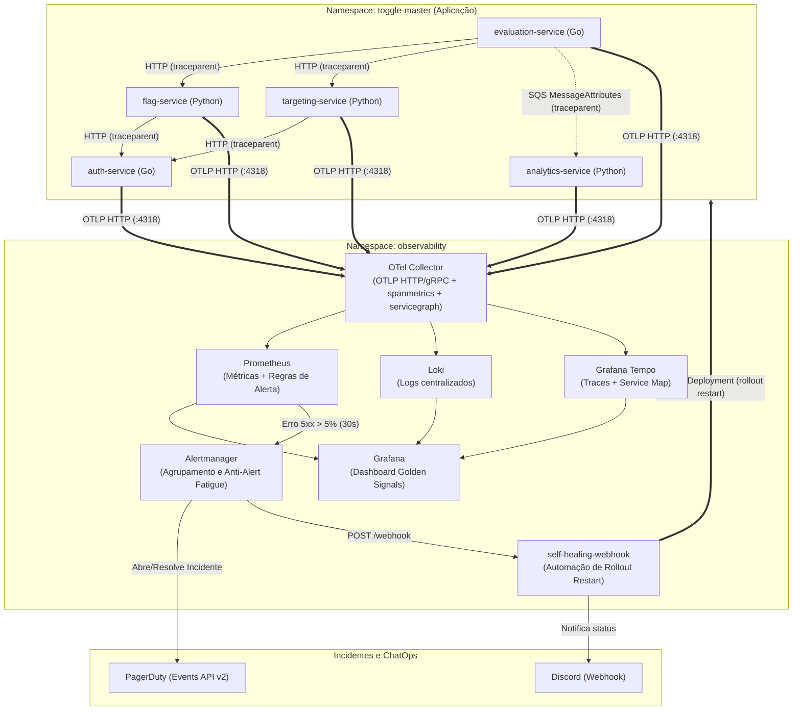

# ToggleMaster — Tech Challenge Fase 4 (Observabilidade, APM e Self-Healing)

Repositório da **Fase 4** do projeto **ToggleMaster** (Pós-Tech FIAP — DevOps & Arquitetura Cloud).  
Nesta etapa, evoluímos a arquitetura em Kubernetes (EKS) e GitOps (ArgoCD) construída nas fases anteriores para resolver o problema de falhas silenciosas nos microsserviços, adicionando coleta padronizada com **OpenTelemetry**, métricas, logs centralizados, rastreamento distribuído (Tracing/Service Map), gestão de incidentes com **PagerDuty**, notificações no **Discord** e **Self-Healing automático** no cluster.

---

## 1. Visão Geral da Arquitetura (Fase 4)

A aplicação é composta por 5 microsserviços rodando no namespace `toggle-master` e uma stack completa de observabilidade e automação rodando no namespace `observability`:

| Serviço | Linguagem | Dependências | Papel na Arquitetura |
| :--- | :--- | :--- | :--- |
| `auth-service` | Go | RDS PostgreSQL (`auth_db`) | Criação e validação de chaves de API (`GET /validate`). |
| `flag-service` | Python (Flask) | RDS PostgreSQL (`flag_db`) + `auth-service` | Cadastro e consulta de Feature Flags. |
| `targeting-service` | Python (Flask) | RDS PostgreSQL (`targeting_db`) + `auth-service` | Regras de segmentação por usuário/atributos. |
| `evaluation-service` | Go | Redis + SQS + `flag-service` + `targeting-service` | Avalia as flags usando cache em memória e publica eventos de uso no SQS. |
| `analytics-service` | Python | AWS SQS + DynamoDB | Consome eventos da fila SQS e grava o histórico no DynamoDB. |

### Fluxo de Telemetria e Resposta a Incidentes



---

## 2. O que foi implementado nesta fase

### 2.1. OpenTelemetry Collector como peça central (`gitops/observability/otel-collector/`)
Em vez de cada microsserviço conhecer o endereço do Prometheus, do Loki ou da ferramenta de APM, todos os 5 serviços enviam seus dados apenas para o `otel-collector` via protocolo **OTLP HTTP** (` porta 4318`).
- **Receivers:** `otlp` (portas `4317` gRPC e `4318` HTTP).
- **Processors e Connectors:**
  - `memory_limiter`, `batch` e `resource`.
  - `spanmetrics`: gera automaticamente métricas de requisição, taxa de erros HTTP (`4xx`/`5xx`) e histogramas de latência (`p50`, `p90`, `p95`, `p99`) a partir dos spans recebidos.
  - `servicegraph`: monta as métricas de origem/destino entre os serviços e bancos para desenhar o **Service Map**.
- **Exporters:** roteia métricas para o **Prometheus** (`:8889`), logs em formato OTLP para o **Loki** (`http://loki:3100/otlp`) e traces para o **Grafana Tempo** (`tempo:4317`).

### 2.2. Instrumentação dos 5 Microsserviços e Propagação de Contexto
O código-fonte dos 5 microsserviços foi instrumentado para propagar o cabeçalho padrão W3C (`traceparent`) de ponta a ponta:
1. Uma chamada em `GET /evaluate` no `evaluation-service` cria o span raiz, registra a consulta ao **Redis** (`Redis Get Cache` / `Redis Set Cache`) e, em caso de *cache miss*, repassa o `traceparent` nas chamadas HTTP para `flag-service` e `targeting-service`.
2. O `flag-service` e o `targeting-service` extraem o `traceparent`, consultam seus respectivos bancos PostgreSQL e repassam o mesmo contexto ao validar o token no `auth-service` (`GET /validate`).
3. Na publicação do evento para a fila **AWS SQS**, o `evaluation-service` injeta o `traceparent` nos `MessageAttributes` da mensagem.
4. O `analytics-service` lê o `traceparent` da mensagem recebida do SQS, continua o mesmo trace e registra o span de escrita no **DynamoDB** (`DynamoDB PutItem`).
5. Todos os logs emitidos pelos serviços incluem `trace_id` e `span_id` no JSON, permitindo ir direto do erro no gráfico para o log no Loki e para o trace correspondente.

### 2.3. Monitoramento no K8s e Dashboard no Grafana (`gitops/observability/grafana/`)
O Grafana já sobe com as datasources (`Prometheus`, `Loki`, `Tempo` e `Alertmanager`) e o dashboard customizado provisionados via ConfigMap:
- **Variável `$service`:** permite filtrar todos os painéis por microsserviço ou visualizar o cluster inteiro.
- **4 Golden Signals + HPA:**
  - *Traffic:* taxa de requisições por segundo (RPS) por serviço.
  - *Errors:* percentual de respostas HTTP `5xx` com linha de limite do alerta (5%) ao lado do painel de logs de erro do Loki.
  - *Latency:* curvas de percentil `p50`, `p90`, `p95` e `p99` ao lado do **Service Map** (Node Graph) e da tabela de traces.
  - *Saturation:* consumo de CPU e memória dos pods no EKS, réplicas atuais vs. máximas do **HPA** e contagem de restarts dos containers.

### 2.4. Alertas Inteligentes, PagerDuty, Discord e Self-Healing (`gitops/observability/self-healing/`)
- **Regras de Alerta (`prometheus/configmap.yml`):**
  - `ToggleMasterHighErrorRate5xx`: dispara quando a taxa de erros HTTP `5xx` de qualquer serviço passa de **5% por 30 segundos** (`severity: critical`, `self_healing: "true"`, `runbook_id: "RB-001"`).
  - `ToggleMasterHighLatencyP95`: dispara warning caso o percentil `p95` passe de `1000ms` por 1 minuto.
- **Prevenção de Alert Fatigue (`alertmanager/configmap.yml`):**
  - Agrupamento por `['alertname', 'service_name', 'namespace']` (`group_wait: 15s`, `group_interval: 1m`, `repeat_interval: 1h`) para não abrir múltiplos incidentes repetidos.
  - Regra de inibição (`inhibit_rules`) que silencia alertas `warning` se o mesmo serviço já estiver com alerta `critical` ativo.
- **Integração PagerDuty + Discord + Self-Healing:**
  - Quando o alerta entra em `Firing`, o Alertmanager aciona o **PagerDuty** (via `Events API v2`) abrindo o incidente automaticamente, e chama o serviço interno `self-healing-webhook` (`POST /webhook`).
  - O `self-healing-webhook` é um controlador Python rodando no namespace `observability` com uma `ServiceAccount` (`self-healing-sa`) e permissão RBAC restrita (`get`, `list`, `patch` em `deployments` do namespace `toggle-master`).
  - Ao receber o alerta, ele valida um *cooldown* de 60 segundos, aplica o `rollout restart` no deployment com falha via API do Kubernetes (`PATCH` na annotation `kubectl.kubernetes.io/restartedAt`) e envia notificações detalhadas no **Discord** (aviso de incidente, confirmação do restart executado e aviso de resolução quando a taxa de erro volta a 0%).

---

## 3. Justificativa Técnica das Escolhas

1. **Arquitetura com OTel Collector:** centraliza o recebimento de telemetria dentro do cluster via protocolo neutro (OTLP). Isso evita acoplamento do código em Go e Python com SDKs proprietários e permite gerar métricas (`spanmetrics`) e mapa de dependências (`servicegraph`) de forma uniforme para qualquer linguagem.
2. **APM e Rastreamento (Grafana Tempo / LGTM + compatibilidade OTLP com New Relic/Datadog):** com o OTel Collector processando os traces via OTLP, mantemos o **Grafana Tempo** integrado nativamente na mesma interface do Grafana (correlacionando métricas do Prometheus, logs do Loki e Service Map na mesma tela sem custo por host), podendo exportar simultaneamente para o endpoint OTLP do New Relic ou Datadog apenas adicionando o exporter no ConfigMap do coletor. Entre Datadog e New Relic, o New Relic oferece ingestão OTLP nativa mais simples sem exigir agentes proprietários pesados nos nós `t3.medium`.
3. **PagerDuty vs. OpsGenie:** optamos pelo **PagerDuty** pela integração direta com a `Events API v2` no Alertmanager (`pagerduty_configs`), suporte nativo a deduplicação por `dedup_key` e fechamento automático do incidente (`send_resolved: true`) assim que o Self-Healing recupera o pod, além do fato de o OpsGenie estar em processo de descontinuação pela Atlassian.

---

## 4. Segurança de Segredos e Decisões de Infraestrutura (Terraform)

- **Zero segredos hardcoded no repositório:** senhas do RDS, chave interna de API do `evaluation-service`, `pagerduty_routing_key` e `discord_webhook_url` são gerenciados como `SecureString` no **AWS SSM Parameter Store** (`terraform/modules/ssm-parameters/`) e injetados no EKS através do **External Secrets Operator (ESO)**.
- **Criptografia e FinOps no RDS (`terraform/modules/rds/`):** todas as instâncias PostgreSQL utilizam discos `gp3` com criptografia em repouso habilitada (`storage_encrypted = true`). Para manter o custo do laboratório acadêmico controlado e permitir destruição rápida do ambiente sem cobrança residual de snapshots, utilizamos Single-AZ (`multi_az = false`), `backup_retention_period = 0` e `skip_final_snapshot = true`.
- **Pipelines CI/CD e IaC (`.github/workflows/`):** workflows para os 5 microsserviços e para o Terraform (`ci-terraform.yml`) com testes unitários, linters (`golangci-lint`, `flake8`, `terraform fmt/validate`) e scans bloqueantes (`exit-code: "1"`) no Trivy e Horusec.

---

## 5. Como Configurar e Testar na Prática

### 5.1. Configurar chaves do PagerDuty e Discord no `terraform.tfvars`
No seu arquivo local `terraform/terraform.tfvars` (ignorado pelo Git), adicione as duas variáveis abaixo antes de rodar o `terraform apply`:

```hcl
pagerduty_routing_key = "SUA_INTEGRATION_KEY_DO_PAGERDUTY"
discord_webhook_url   = "SUA_URL_DO_WEBHOOK_DO_DISCORD"
```

### 5.2. Acessar o Grafana e o ArgoCD
```bash
# Port-forward do Grafana (usuário: admin / senha: togglemaster-admin)
kubectl port-forward -n observability svc/grafana 3000:3000
# Acesse: http://localhost:3000

# Port-forward do ArgoCD
kubectl port-forward -n argocd svc/argocd-server 8080:443
# Acesse: https://localhost:8080
```

### 5.3. Simular Falha e Validar o Self-Healing ("A Prova Real")
Cada microsserviço possui um endpoint `/chaos?enable=true` que força retorno `HTTP 500` nas rotas de negócio mantendo a rota `/health` em `200 OK` (simulando uma falha silenciosa de negócio para que a `livenessProbe` do Kubernetes não mate o pod antes do alerta de observabilidade agir).

Para executar o teste completo automatizado:
```bash
# Em um terminal secundário, acompanhe os pods:
kubectl get pods -n toggle-master -w

# No terminal principal, dispare a simulação (ex: no auth-service):
./scripts/test-chaos-self-healing.sh auth-service

# Para ver o log detalhado do controlador de Self-Healing:
kubectl logs -n observability deploy/self-healing-webhook -f
```
