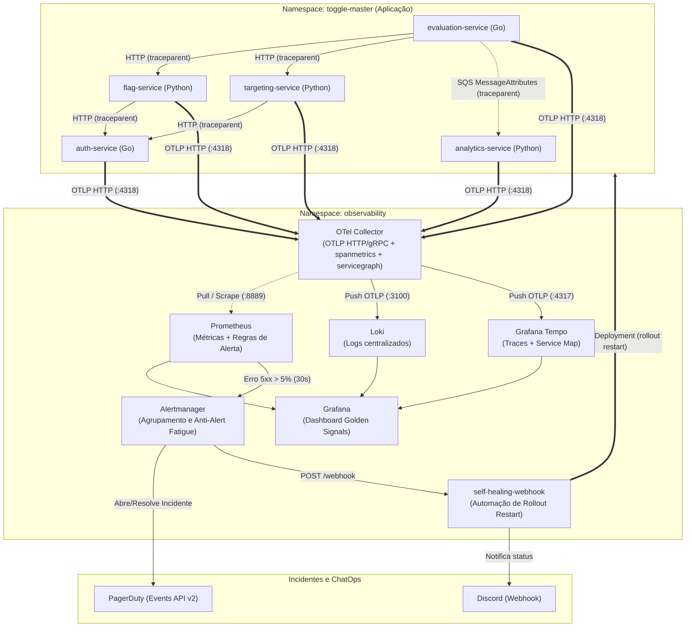
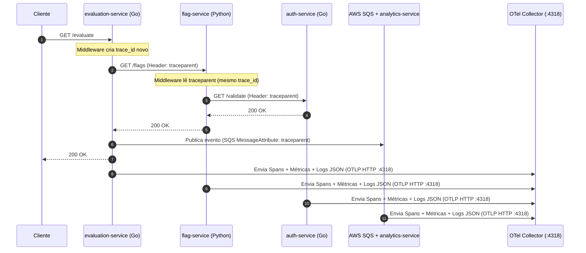
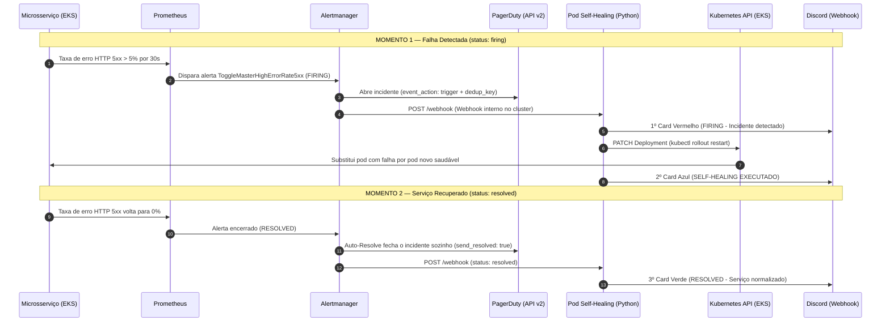

# ToggleMaster — Tech Challenge Fase 4 (Observabilidade, APM e Self-Healing)

Repositório da **Fase 4** do projeto **ToggleMaster** (Pós-Tech FIAP — DevOps & Arquitetura Cloud).  
Nesta etapa, evoluímos a arquitetura em Kubernetes (EKS) e GitOps (ArgoCD) construída nas fases anteriores para resolver o problema de falhas silenciosas nos microsserviços, adicionando coleta padronizada com **OpenTelemetry**, métricas, logs centralizados, rastreamento distribuído (Tracing/Service Map), gestão de incidentes com **PagerDuty**, notificações no **Discord** e **Self-Healing automático** no cluster.

---

## 1. Visão Geral da Arquitetura (Fase 4)

A aplicação é composta por 5 microsserviços rodando no namespace `toggle-master` e uma stack completa de observabilidade e automação rodando no namespace `observability`:

| Serviço | Linguagem | Dependências | Papel na Arquitetura |
| :--- | :--- | :--- | :--- |
| `auth-service` | Go | RDS PostgreSQL (`auth_db`) | Criação e validação de chaves de API (`GET /validate`). |
| `flag-service` | Python (Flask) | RDS PostgreSQL (`flag_db`) + `auth-service` | Cadastro e consulta de Feature Flags. |
| `targeting-service` | Python (Flask) | RDS PostgreSQL (`targeting_db`) + `auth-service` | Regras de segmentação por usuário/atributos. |
| `evaluation-service` | Go | Redis + SQS + `flag-service` + `targeting-service` | Avalia as flags usando cache em memória e publica eventos de uso no SQS. |
| `analytics-service` | Python | AWS SQS + DynamoDB | Consome eventos da fila SQS e grava o histórico no DynamoDB. |

### Fluxo de Telemetria e Resposta a Incidentes



---

## 2. O que foi implementado nesta fase

### 2.1. OpenTelemetry Collector como peça central (`gitops/observability/otel-collector/`)
Em vez de cada microsserviço conhecer o endereço do Prometheus, do Loki ou da ferramenta de APM, todos os 5 serviços enviam seus dados apenas para o `otel-collector` via protocolo **OTLP HTTP** (` porta 4318`).
- **Receivers:** `otlp` (portas `4317` gRPC e `4318` HTTP).
- **Processors e Connectors:**
  - `memory_limiter`, `batch` e `resource`.
  - `spanmetrics`: gera automaticamente métricas de requisição, taxa de erros HTTP (`4xx`/`5xx`) e histogramas de latência (`p50`, `p90`, `p95`, `p99`) a partir dos spans recebidos.
  - `servicegraph`: monta as métricas de origem/destino entre os serviços e bancos para desenhar o **Service Map**.
- **Exporters:** expõe métricas para coleta (*Pull/Scrape*) do **Prometheus** (`:8889`), e envia (*Push*) logs em formato OTLP para o **Loki** (`http://loki:3100/otlp`) e traces para o **Grafana Tempo** (`tempo:4317`).

### 2.2. Instrumentação dos 5 Microsserviços e Propagação de Contexto
Em vez de usar webhooks para telemetria, adicionamos um **Middleware do OpenTelemetry** na entrada e saída de cada um dos 5 microsserviços (`otel.go` nos serviços em Go e `telemetry.py` nos serviços em Python/Flask):

1. **Na Entrada do Serviço (Lê o Header `traceparent`):** quando uma requisição chega, o Middleware verifica os cabeçalhos HTTP. Se for o primeiro serviço (`evaluation-service`), ele cria um `trace_id` novo. Se for um serviço seguinte (`flag-service`, `targeting-service` ou `auth-service`), ele lê o cabeçalho padrão W3C **`traceparent`** enviado pelo serviço anterior e continua usando o mesmo `trace_id`.
2. **Na Saída para o Próximo Serviço (Repassa o `traceparent`):** quando um serviço faz uma chamada HTTP para outro ou publica uma mensagem na fila **AWS SQS** (usando `MessageAttributes`), o código injeta o cabeçalho `traceparent` para que o próximo serviço saiba que faz parte da mesma requisição.
3. **Ao Finalizar a Requisição (Envia OTLP na porta `4318`):** ao terminar de responder, o Middleware calcula o tempo de duração, captura o status HTTP (`200`, `500`, etc.), anexa o `trace_id` e `span_id` nos logs JSON e envia tudo via protocolo **OTLP HTTP** para o `otel-collector` (`http://otel-collector.observability:4318`). É assim que o Grafana costura os 5 serviços no mesmo Trace Distribuído e desenha o **Service Map**.



### 2.3. Monitoramento no K8s e Dashboard no Grafana (`gitops/observability/grafana/`)
O Grafana já sobe com as datasources (`Prometheus`, `Loki`, `Tempo` e `Alertmanager`) e o dashboard customizado provisionados via ConfigMap (`configmap-dashboard.yml`), organizado em **4 faixas (rows)** com layout lado a lado (métricas à esquerda e diagnóstico de logs/traces à direita):

1. **Faixa 1 — Visão Executiva SRE (5 Cards no Topo):**
   - **🚦 Total de Requisições:** soma de todas as chamadas de negócio recebidas pelos microsserviços (ignorando `/health`).
   - **🔥 Errors (Taxa 5xx %):** porcentagem global de erros HTTP 500 no momento (fica verde abaixo de 1%, amarelo acima de 1% e vermelho acima de 5%).
   - **🚨 Alertas Ativos (Firing):** quantidade de alertas disparados no Prometheus naquele instante.
   - **🩺 Pods Ativos (HPA):** total de containers da aplicação rodando no namespace `toggle-master`.
   - **🖥️ Nodes EKS Ativos (Cluster):** quantidade de máquinas EC2 (`t3.medium`) saudáveis no cluster Kubernetes.

2. **Faixa 2 — Diagnóstico de Erros Lado a Lado:**
   - **Esquerda (`🔥 Golden Signal: Errors — Taxa de Erro HTTP 5xx por Microsserviço`):** gráfico de linha mostrando qual dos 5 microsserviços está gerando erro 500, com uma faixa vermelha marcando o limite do alerta (`5%`).
   - **Direita (`🪵 Causa Raiz Imediata: Logs de ERRO em Tempo Real`):** painel do **Loki** filtrando automaticamente apenas linhas com `ERROR` (`{service_name=~".+"} |= "ERROR"`), exibindo a mensagem do erro e o `trace_id` clicável.

3. **Faixa 3 — Performance, Tráfego & APM Lado a Lado:**
   - **Esquerda Superior (`⏱️ Golden Signal: Latency`):** tempo médio de resposta (em milissegundos) de cada microsserviço.
   - **Direita Superior (`🗺️ Service Graph Metrics: Client ➔ Server RPS`):** taxa de chamadas por segundo de um serviço para outro (ex: `evaluation-service ➔ flag-service`), gerada pelo conector `servicegraph` do OTel Collector.
   - **Esquerda Inferior (`🚦 Golden Signal: Traffic`):** volume de requisições recebidas por cada um dos 5 microsserviços.
   - **Direita Inferior (`🔎 Distributed Tracing — Grafana Tempo`):** tabela ao vivo com os últimos traces recebidos; clicando no `TraceID`, abre o **Flamegraph** detalhando cada etapa da requisição (HTTP, Redis, Postgres, SQS e DynamoDB).

4. **Faixa 4 — Escalabilidade do EKS, Saturação e Stream de Logs Lado a Lado:**
   - **Esquerda Superior (`🖥️ Escalabilidade do Cluster EKS & Réplicas HPA`):** mostra o número de Worker Nodes ativos por zona da AWS e quantas réplicas o **HPA** mantém para cada microsserviço.
   - **Esquerda Inferior (`📈 Golden Signal: Saturation — Uso de CPU por Pod`):** consumo de CPU (em cores) de cada pod no namespace `toggle-master`.
   - **Direita (`📜 Stream Completo de Logs Estruturados OTLP`):** todos os logs (`INFO`, `WARN` e `ERROR`) dos 5 microsserviços em tempo real no Loki (ocultando o ruído de `/health`).

### 2.4. Alertas Inteligentes, PagerDuty, Discord (ChatOps) e Self-Healing (`gitops/observability/self-healing/`)

#### 1. Explicação de Cada Alerta (`prometheus/configmap.yml`)
- **`ToggleMasterHighErrorRate5xx` (Severidade: `critical` | `self_healing: "true"` | Runbook `RB-001`):**
  - **O que monitora:** calcula a proporção de respostas HTTP `5xx` sobre o tráfego total de cada microsserviço.
  - **Por que é inteligente:** exige que a taxa de erro fique **acima de 5% por 30 segundos seguidos** (`for: 30s`), evitando alarmes falsos por oscilações rápidas de rede.
  - **O que faz:** abre incidente crítico no **PagerDuty**, notifica no **Discord** e aciona o **Self-Healing** para reiniciar o pod com falha.
- **`ToggleMasterHighLatencyP95` (Severidade: `warning` | `self_healing: "false"` | Runbook `RB-002`):**
  - **O que monitora:** verifica se o percentil `p95` de latência de algum serviço passou de **1000ms (1 segundo) por 1 minuto seguido** (`for: 1m`).
  - **O que faz:** emite apenas um alerta de **aviso (Warning)** para investigação de lentidão no banco/cache, mas **não reinicia o pod** (`self_healing: "false"`), pois reiniciar um pod durante pico de lentidão no banco agravaria o problema.

#### 2. Prevenção de Alert Fatigue (`alertmanager/configmap.yml`)
- **Agrupamento (`group_by`):** agrupa alertas por `['alertname', 'service_name', 'namespace']` (`group_wait: 15s`, `group_interval: 1m`, `repeat_interval: 1h`) para não disparar dezenas de mensagens repetidas.
- **Deduplicação (`dedup_key`):** envia uma chave única do incidente para o PagerDuty, garantindo que apenas **1 chamado** seja aberto por falha.
- **Regra de Inibição (`inhibit_rules`):** se um serviço já estiver com o alerta **Crítico** de Erro 500 (`ToggleMasterHighErrorRate5xx`) ativo, o Alertmanager **silencia automaticamente** o alerta **Warning** de Lentidão (`ToggleMasterHighLatencyP95`) daquele mesmo serviço para não duplicar notificações.

#### 3. Passo a Passo do Fluxo (Prometheus ➔ Alertmanager ➔ PagerDuty, Self-Healing e Discord)

1. **Momento 1 — Quando a falha acontece (`status: firing`):**
   - O **Prometheus** detecta que o erro 5xx passou de 5% por 30s e envia o alerta para o **Alertmanager**.
   - O **Alertmanager** faz dois disparos simultâneos:
     1. Chama a API do **PagerDuty** (`Events API v2`) abrindo o incidente para o plantonista;
     2. Chama o **1º Webhook (Interno)** do nosso pod `self-healing-webhook` (`POST http://self-healing-webhook.observability:8080/webhook`).
   - O pod **`self-healing-webhook`** (Python com RBAC restrito `self-healing-sa` e *cooldown* de 60s):
     1. Chama o **2º Webhook (Externo do Discord)** enviando o **1º Card Vermelho (`🚨 [FIRING]`)**;
     2. Chama a **API do Kubernetes** executando o `kubectl rollout restart` (`PATCH` no Deployment do serviço com falha no namespace `toggle-master`);
     3. Chama novamente o **Webhook do Discord** enviando o **2º Card Azul (`🛠️ [SELF-HEALING EXECUTADO]`)**.

2. **Momento 2 — Quando o serviço se recupera (`status: resolved`):**
   - Assim que o pod novo sobe saudável, o **Prometheus** mede que a taxa de erro 5xx voltou para **0%** e avisa o **Alertmanager** que o alerta foi encerrado.
   - O **Alertmanager** envia o comando de **Auto-Resolve** (`send_resolved: true`) para o **PagerDuty**, que fecha o incidente sozinho.
   - O **Alertmanager** avisa o `self-healing-webhook` (`status: resolved`), que envia o **3º Card Verde (`🟢 [RESOLVED]`)** no **Webhook do Discord**.

#### Diagrama de Sequência: Fluxo de Alerta, ChatOps e Self-Healing



---

## 3. Evidências Práticas de Funcionamento (Prints da Fase 4)

Abaixo estão as evidências reais coletadas no cluster **Amazon EKS** demonstrando o funcionamento fim-a-fim da observabilidade, rastreamento distribuído (APM), gestão de incidentes e automação de Self-Healing.

### 3.1. Dashboard do Grafana — Operação Normal (4 Golden Signals, APM e Logs)
Visão do dashboard provisionado via GitOps com o ambiente saudável (`0%` de erros HTTP 5xx, `0` alertas ativos, `5` pods rodando sob HPA e `2` Worker Nodes EKS ativos). Os painéis exibem os **4 Golden Signals** (Latência, Tráfego, Erros e Saturação de CPU), as métricas do **Service Graph** (`Client ➔ Server RPS`), a lista de traces distribuídos no **Grafana Tempo** e o stream de logs JSON estruturados no **Grafana Loki** contendo `trace_id` e `span_id`:


---

### 3.2. Dashboard do Grafana em Alerta — Diagnóstico Lado a Lado (Métrica + Log de Causa Raiz)
Momento em que a falha silenciosa é injetada no `auth-service`: o card de **Errors (Taxa 5xx %)** fica vermelho (`43.9%`) e o card **Alertas Ativos (Firing)** passa para `1`. Na **Faixa 2 (Diagnóstico Lado a Lado)**, o gráfico da esquerda mostra o pico de erros HTTP 500 ultrapassando o limite de `5%`, enquanto o painel do **Loki** imediatamente à direita exibe em tempo real o log `ERROR` com a causa raiz exata (`"Falha critica HTTP 500 no auth-service: conexao com banco recusada"`) e o `trace_id` clicável:


---

### 3.3. Trace Distribuído Completo no APM (Grafana Tempo)
Detalhamento (*Flamegraph*) do trace distribuído `6f0154c64586dbf8cd8f3f8074fb4941` (`15 spans`, duração total de `437.57ms`) demonstrando a propagação do cabeçalho W3C `traceparent` entre chamadas HTTP síncronas e mensageria assíncrona no **AWS SQS**:
1. Entrada no `evaluation-service` (`GET /evaluate`) e consulta ao cache no **Redis** (`redis.get_flag_cache`);
2. Chamada HTTP ao `targeting-service` (`GET /rules/enable-new-dashboard`), que valida a chave no `auth-service` (`GET /validate`) e consulta o **RDS PostgreSQL** (`postgres.validate_api_key`);
3. Chamada HTTP ao `flag-service` (`GET /flags/enable-new-dashboard`) com validação no `auth-service`;
4. Publicação assíncrona do evento na fila **AWS SQS** (`sqs.publish_evaluation_event`), consumo pelo `analytics-service` (`SQS Process EvaluationEvent`) e gravação no **Amazon DynamoDB** (`DynamoDB PutItem`).


---

### 3.4. Notificação de Incidente Aberto no PagerDuty (`Triggered`)
Quando o alerta `ToggleMasterHighErrorRate5xx` entra em estado `FIRING` no Prometheus, o **Alertmanager** aciona a `Events API v2` do **PagerDuty**, abrindo automaticamente o incidente crítico (`#7 - 🚨 Alta Taxa de Erros HTTP 5xx em auth-service`) no serviço `ToggleMaster - EKS Production` para o engenheiro de plantão:


---

### 3.5. Histórico de Incidentes e Auto-Resolve no PagerDuty (`Resolved`)
Tela de *Recent Activity* do **PagerDuty** comprovando que, após o controlador de **Self-Healing** reiniciar o deployment do microsserviço degradado e a taxa de erros voltar a `0%`, o Alertmanager envia o evento de resolução (`send_resolved: true`) e encerra o chamado automaticamente (`Resolved through the integration API`) sem intervenção manual:


---

### 3.6. Notificações de ChatOps no Discord (Ciclo Completo em 3 Cards)
No canal `#incidentes-self-healing` do **Discord**, o bot `ToggleMaster SRE • Runbook & Self-Healing Bot` documenta todas as etapas do incidente em tempo real:
1. **Card Vermelho (`🚨 [FIRING]`):** avisa que a taxa de erros HTTP 5xx do `auth-service` atingiu `75.47%` (acima do limite de `5%`), informa a abertura do incidente no PagerDuty e aciona a automação do Runbook `RB-001`;
2. **Card Azul (`🛠️ [SELF-HEALING EXECUTADO]`):** confirma que o controlador executou o comando `kubectl rollout restart deployment/auth-service -n toggle-master` via API do Kubernetes (`RollingUpdate`);
3. **Card Verde (`🟢 [RESOLVED]`):** confirma que a taxa de erros HTTP 5xx voltou para `0%` após o *rollout restart* e que o incidente foi fechado automaticamente (`Auto-Resolved`) no PagerDuty.


---

### 3.7. Log de Execução da Automação de Self-Healing no Cluster EKS
Evidência de terminal lado a lado durante a execução do teste prático:
- **Esquerda:** logs da simulação confirmando a estabilização pós-cura e o retorno do tráfego normal após a atuação do controlador;
- **Direita (`kubectl get pods -n toggle-master -w`):** o exato momento em que o **Self-Healing** dispara o `RollingUpdate` no Kubernetes — o novo pod saudável (`auth-service-5499cf64d7-qzvbp`) é criado (`Pending` ➔ `ContainerCreating` ➔ `Running 1/1`) antes de o pod antigo com falha (`auth-service-6cf8848f9c-82686`) ser finalizado (`Terminating`), garantindo recuperação automática sem indisponibilidade:


---

## 4. Justificativa Técnica das Escolhas

1. **Arquitetura com OTel Collector:** centraliza o recebimento de telemetria dentro do cluster via protocolo neutro (OTLP). Isso evita acoplamento do código em Go e Python com SDKs proprietários e permite gerar métricas (`spanmetrics`) e mapa de dependências (`servicegraph`) de forma uniforme para qualquer linguagem.
2. **APM e Rastreamento (Grafana Tempo / LGTM + compatibilidade OTLP com New Relic/Datadog):** com o OTel Collector processando os traces via OTLP, mantemos o **Grafana Tempo** integrado nativamente na mesma interface do Grafana (correlacionando métricas do Prometheus, logs do Loki e Service Map na mesma tela sem custo por host), podendo exportar simultaneamente para o endpoint OTLP do New Relic ou Datadog apenas adicionando o exporter no ConfigMap do coletor. Entre Datadog e New Relic, o New Relic oferece ingestão OTLP nativa mais simples sem exigir agentes proprietários pesados nos nós `t3.medium`.
3. **PagerDuty vs. OpsGenie:** optamos pelo **PagerDuty** pela integração direta com a `Events API v2` no Alertmanager (`pagerduty_configs`), suporte nativo a deduplicação por `dedup_key` e fechamento automático do incidente (`send_resolved: true`) assim que o Self-Healing recupera o pod, além do fato de o OpsGenie estar em processo de descontinuação pela Atlassian.

---

## 5. Segurança de Segredos e Decisões de Infraestrutura (Terraform)

- **Zero segredos hardcoded no repositório:** senhas do RDS, chave interna de API do `evaluation-service`, `pagerduty_routing_key` e `discord_webhook_url` são gerenciados como `SecureString` no **AWS SSM Parameter Store** (`terraform/modules/ssm-parameters/`) e injetados no EKS através do **External Secrets Operator (ESO)**.
- **Criptografia e FinOps no RDS (`terraform/modules/rds/`):** todas as instâncias PostgreSQL utilizam discos `gp3` com criptografia em repouso habilitada (`storage_encrypted = true`). Para manter o custo do laboratório acadêmico controlado e permitir destruição rápida do ambiente sem cobrança residual de snapshots, utilizamos Single-AZ (`multi_az = false`), `backup_retention_period = 0` e `skip_final_snapshot = true`.
- **Pipelines CI/CD e IaC (`.github/workflows/`):** workflows para os 5 microsserviços e para o Terraform (`ci-terraform.yml`) com testes unitários, linters (`golangci-lint`, `flake8`, `terraform fmt/validate`) e scans bloqueantes (`exit-code: "1"`) no Trivy e Horusec.

---

## 6. Como Configurar e Testar na Prática

### 6.1. Configurar chaves do PagerDuty e Discord no `terraform.tfvars`
No seu arquivo local `terraform/terraform.tfvars` (ignorado pelo Git), adicione as duas variáveis abaixo antes de rodar o `terraform apply`:

```hcl
pagerduty_routing_key = "SUA_INTEGRATION_KEY_DO_PAGERDUTY"
discord_webhook_url   = "SUA_URL_DO_WEBHOOK_DO_DISCORD"
```

### 6.2. Acessar o Grafana e o ArgoCD
```bash
# Port-forward do Grafana (usuário: admin / senha: togglemaster-admin)
kubectl port-forward -n observability svc/grafana 3000:3000
# Acesse: http://localhost:3000

# Port-forward do ArgoCD
kubectl port-forward -n argocd svc/argocd-server 8080:443
# Acesse: https://localhost:8080
```

### 6.3. Simular Falha e Validar o Self-Healing ("A Prova Real")
Cada microsserviço possui um endpoint `/chaos?enable=true` que força retorno `HTTP 500` nas rotas de negócio mantendo a rota `/health` em `200 OK` (simulando uma falha silenciosa de negócio para que a `livenessProbe` do Kubernetes não mate o pod antes do alerta de observabilidade agir).

Para executar o teste completo automatizado:
```bash
# Em um terminal secundário, acompanhe os pods:
kubectl get pods -n toggle-master -w

# No terminal principal, dispare a simulação (ex: no auth-service):
./scripts/test-chaos-self-healing.sh auth-service

# Para ver o log detalhado do controlador de Self-Healing:
kubectl logs -n observability deploy/self-healing-webhook -f
```
